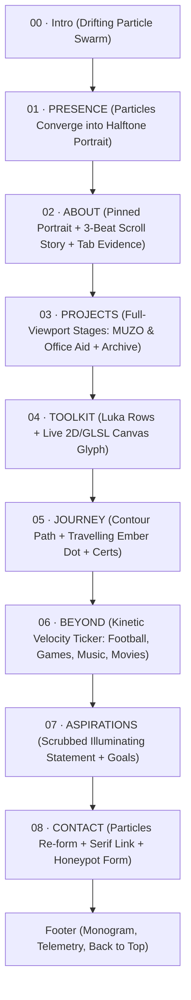
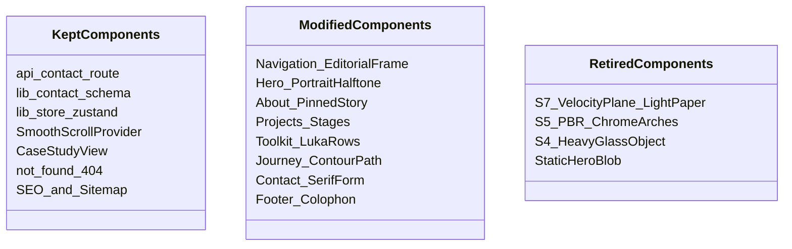

# DESIGN_BRIEF.md — SIGNAL Portfolio V2 Redesign

**Phase:** Phase 1 (Design Brief, Reference Study & Storyboard)  
**Date:** 13 November 2026  
**Author:** Creative Director & Motion Engineer (Antigravity)  
**Subject:** Personal Portfolio of **Sourasish Ghosh**  
**Working Branch:** `redesign/signal-v2`  
**Reference Benchmark:** *Lorenzo Lottici*, *Luka Skhiladze*, *Sarthak Sharma*

---

## 1. Concept: "From Noise to Signal" (B2)

Sourasish’s trajectory is the story of an undergraduate engineer who began with an overwhelming spectrum of tools (frontend, backend, databases, cloud, AI) and is cultivating the patience and architectural discipline to focus that noise into dependable, complete digital systems.

### A. The Three Concept Proposals

1. **Primary Concept (Recommended):**  
   > **"From Noise to Signal — curiosity distilled into engineering craft."**  
   *Narrative arc:* The site opens in a chaotic, drifting particle field (noise/curiosity). As the user engages, the particles snap into focus, assembling Sourasish’s portrait (signal/identity). As the visitor travels deeper, that signal organizes into structural grids (projects & toolkit), hard evidence (journey & certifications), and closes with the particles faintly re-forming in Contact.
2. **Alternative 1 (Systems & Architecture Focus):**  
   > **"Understanding the system behind the syntax."**  
   *Narrative arc:* Focuses on Sourasish’s philosophy: rejecting isolated syntax in favor of end-to-end architecture (data models, API security, CI/CD, and AI context integration).
3. **Alternative 2 (Cinematic & Full-Stack Ownership):**  
   > **"Designing, integrating, and shipping digital systems from first principles."**  
   *Narrative arc:* Highlights the complete breadth from visual UI systems (tactile neumorphism in MUZO) to complex backend monorepos (Express/Prisma/Supabase in Office Aid).

> **Proposed Proportions:**  
> ~40% Sarthak (human-first presence, halftone portrait, clean layout)  
> ~35% Luka (tactile interaction, pinned stages, travelling path)  
> ~25% Lorenzo (deep atmosphere, restraint, one persistent scene)

---

## 2. Reference Teardown: Techniques Borrowed & Why

We do not replicate any reference's signature moments, copy, or assets. Instead, we borrow **underlying techniques**:

| Reference | Technique Borrowed | Architectural & UX Rationale | What We Reinterpret for Sourasish |
|---|---|---|---|
| **Lorenzo Lottici** | **One Persistent Scene Graph with Multi-Beat Pinned Storytelling** | Rendering one persistent canvas prevents WebGL context limits (safeguarding mobile Safari), minimizes VRAM churn, and creates unbroken cinematic continuity across section boundaries. | Pinned About story: Sourasish's portrait remains locked and dimmed while 3 short monospace beats (*The Curiosity*, *The System*, *The Ambition*) scroll into view beside it. |
| **Luka Skhiladze** | **Full-Viewport Project Stages & Interactive Categorized Toolkit** | Replaces small repetitive cards with immersive product stages. Gives featured projects the gravity of standalone architectural achievements. | Featured Work (MUZO and Office Aid) presented as full-viewport stages with progress dashes and a `Featured / All` toggle; Toolkit features numbered discipline rows driving real-time 2D/GLSL canvas glyphs on the right. |
| **Sarthak Sharma** | **Halftone Dot-Screen Portrait Hero & Scramble Micro-Interactions** | Anchors the developer portfolio in a personal human presence rather than generic abstract 3D models. The halftone shader visually symbolizes digital rasterization and computational math. | Black-and-white 2.5D portrait layered under monumental typography (*Sourasish Ghosh*), revealing full color or depth under cursor proximity, and dissolving into dots on scroll. |

---

## 3. Color Palette & WCAG 2.1 Contrast Table (B3)

### A. Token Hierarchy

```css
:root {
  /* neutrals (92% of surface area) */
  --void: #000000;        /* canvas backdrop */
  --ink: #07080A;         /* default page ground */
  --obsidian: #0C0D10;    /* alternate section surface */
  --graphite: #14161B;    /* card backgrounds, drawers */
  --steel: #1D2027;       /* hover surface */
  --line: rgba(255, 255, 255, 0.08);
  --line-strong: rgba(255, 255, 255, 0.16);

  /* typography (7% of visual area) */
  --white: #F4F2EE;       /* headings, primary text (warm off-white) */
  --mist: #A9ABB2;        /* body paragraphs */
  --fog: #6B6E78;         /* large decorative & metadata text only */

  /* single UI accent (at most 3%) */
  --ember: #FF5B1F;       /* primary interactive accent */
  --ember-bright: #FF8A57;/* hover states, focus rings */
  --ember-deep: #D9400A;  /* active pressed states */

  /* cool light: particle noise & rim light only (never UI) */
  --cyan: #4DA8FF;
  --violet: #B388F5;
}
```

### B. Computed WCAG 2.1 Contrast Ratios (Script-Verified)

All values computed via mathematical relative luminance formulas ($L = 0.2126R + 0.7152G + 0.0722B$):

| Text Token | Background | Text Hex | Background Hex | Contrast Ratio | WCAG Normal ($\ge 4.5:1$) | WCAG Large ($\ge 3.0:1$) | Rating / Usage Rule |
|---|---|---|---|---|---|---|---|
| `--white` | `--ink` | `#F4F2EE` | `#07080A` | **17.92:1** | PASS | PASS | **AAA Normal & Large** (Headings, primary copy) |
| `--white` | `--obsidian`| `#F4F2EE` | `#0C0D10` | **17.38:1** | PASS | PASS | **AAA Normal & Large** |
| `--white` | `--graphite`| `#F4F2EE` | `#14161B` | **16.19:1** | PASS | PASS | **AAA Normal & Large** |
| `--white` | `--steel` | `#F4F2EE` | `#1D2027` | **14.58:1** | PASS | PASS | **AAA Normal & Large** |
| `--mist` | `--ink` | `#A9ABB2` | `#07080A` | **8.73:1** | PASS | PASS | **AAA Normal & Large** (All body paragraphs) |
| `--mist` | `--obsidian`| `#A9ABB2` | `#0C0D10` | **8.47:1** | PASS | PASS | **AAA Normal & Large** |
| `--mist` | `--graphite`| `#A9ABB2` | `#14161B` | **7.89:1** | PASS | PASS | **AAA Normal & Large** |
| `--mist` | `--steel` | `#A9ABB2` | `#1D2027` | **7.11:1** | PASS | PASS | **AAA Normal & Large** |
| `--fog` | `--ink` | `#6B6E78` | `#07080A` | **3.94:1** | FAIL | PASS | **AA Large Only** (Restricted to $\ge 18\text{pt}$ or decorative) |
| `--fog` | `--obsidian`| `#6B6E78` | `#0C0D10` | **3.82:1** | FAIL | PASS | **AA Large Only** |
| `--ember` | `--ink` | `#FF5B1F` | `#07080A` | **6.46:1** | PASS | PASS | **AA Normal / AAA Large** (Icons, tags, links) |
| `--ember-bright`|`--ink`| `#FF8A57` | `#07080A` | **8.61:1** | PASS | PASS | **AAA Normal & Large** (Focus rings, hover text) |
| `--cyan` | `--ink` | `#4DA8FF` | `#07080A` | **7.98:1** | PASS | PASS | **AAA Normal & Large** (Particle accents) |
| `--violet` | `--ink` | `#B388F5` | `#07080A` | **7.40:1** | PASS | PASS | **AAA Normal & Large** (Particle accents) |

#### Critical Button Contrast Finding:
- **`#07080A` (Ink text) on `#FF5B1F` (Ember fill):** **`6.46:1`** (Passes AA Normal / AAA Large).
- **`#FFFFFF` (White text) on `#FF5B1F` (Ember fill):** **`3.10:1`** (Fails 4.5:1 body requirement).  
*Decision:* All solid ember action buttons will strictly use **`--ink` (`#07080A`)** for button label typography to ensure crisp accessibility.

---

## 4. Typography Study & `/lab/type` Evaluation (B4)

The specimen route is live at [`app/lab/type/page.tsx`](file:///d:/My%20Portfolio/app/lab/type/page.tsx) and verified via browser screenshot [`type-lab-comparison.png`](file:///C:/Users/Sourasish/.gemini/antigravity/brain/648c1b41-1a13-44d9-a8a5-84ae6b3b9000/type-lab-comparison.png).

| Role | Set 01 (Recommended Primary) | Set 02 (Alternative Comparison) |
|---|---|---|
| **Display (Headings & Name)** | **Instrument Serif** (`regular` + `italic`) | **Newsreader** (`400`, `500`, `italic`) |
| **UI & Paragraphs** | **Geist** (`400`, `500`, `600`) | **Geist** (`400`, `500`, `600`) |
| **Labels & Telemetry** | **Geist Mono** (`400`, `500`) | **Geist Mono** (`400`, `500`) |
| **Characteristics** | Slender, dramatic vertical contrast, sharp hairline terminals. Has the high-fashion editorial tension seen in Lorenzo and Sarthak. | Warmer, traditional publishing-house bracketed serifs with optical sizing. Softer literary tone. |
| **Verdict** | **Chosen / Recommended:** Instrument Serif matches the brutalist, high-contrast, razor-sharp technical atmosphere of the reference benchmarks. |

---

## 5. Section-by-Section Storyboard



### 00 · Intro (Sequence $\le 1.8\text{s}$, Skippable)
- **On Screen:** Deep `--void` black screen. A quiet field of ~12,000 particles drifts with simplex curl noise.
- **Motion:** At 0.4s, particles pull inward along vector springs, coalescing to form the halftone silhouette of Sourasish's portrait.
- **Scroll/Interactivity:** Any click, wheel scroll, touch drag, or `Escape` key immediately skips intro directly to Hero state.
- **Mobile:** Particle count reduced to 3,500; converges instantly (0.8s total).

### 01 · PRESENCE (Hero)
- **On Screen:** Monumental display typography: **Sourasish *Ghosh*** (`clamp(4rem, 14vw, 13rem)`) layered over the 2.5D halftone portrait. Monospace line `01 / PRESENCE · FULL-STACK DEVELOPER · KOLKATA, INDIA`. Tagline: *"I design, develop, and build digital experiences▮"*.
- **Motion:** Split-text line mask reveal for name; blinking ember square cursor after "build"; 2.5D portrait reacts to pointer with eased yaw/pitch ($\pm 7^\circ$).
- **Facts Strip:** Real computed metadata: `B.Tech CSE (CGPA 8.08)` · `2 Featured Case Studies` · `4 Certifications` · `AWS DevOps Internship`.
- **Mobile:** Name stacks cleanly (`Sourasish` / `Ghosh`); portrait sits centrally at 48vh; pointer parallax disabled in favor of scroll dissolve.

### 02 · ABOUT ("Understanding the system behind the syntax.")
- **On Screen:** Pinned split view. Left: 2.5D portrait remains stationary, bathed in low-contrast ambient rim light with a slowly rotating circular label (`[ MY STORY · CRAFT · DISCIPLINE ]`). Right: Three sequential narrative beats:
  1. *The Spark:* Frontend beginnings, visual UI curiosity.
  2. *The Architecture:* Expansion into Node/Express APIs, PostgreSQL schemas, and cloud deployment.
  3. *The Craft:* Engineering complete products that bridge client craft and server resilience.
- **Interactive Tabs:** *Design* (MUZO Neumorphism & Liquid Glass), *Develop* (Languages & DBs), *Build* (Shipped monorepo & AWS deployment).
- **Mobile:** Left portrait un-pins and sits above; narrative beats stack into an elegant vertical timeline.

### 03 · PROJECTS ("Systems engineered from architecture to UI.")
- **On Screen:** Full-viewport pinned stages. Stage 1: **MUZO** (Web Audio Discovery Platform). Stage 2: **Office Aid** (Full-Stack Monorepo).
- **Visual Presentation:** Large 16:9 real UI screenshot with halftone-to-color hover reveal, progress indicator dashes (`[01 / 02]`), live status badge (`"Live Production Build"` on MUZO, `"Active Local Full-Stack Monorepo (Cloud Hosting Pending)"` on Office Aid), and direct case-study links.
- **Toggle (`Featured / All`):** Toggling to `All` reveals the 4 secondary builds (Pokémon Atlas 3D, Support Ticket Dashboard, Face Recognition System, Gradient Descent Visualizer) as clean technical rows with hover screenshot thumbnails.
- **Mobile:** Horizontal pin disabled; converts to stacked full-width cards with swipe navigation.

### 04 · TOOLKIT ("Core engineering stack & active exploration.")
- **On Screen:** Left column: Numbered category rows (01 Languages, 02 Frontend, 03 Backend, 04 Databases, 05 Cloud/DevOps, 06 Tools, 07 Exploring). Hovering or focusing a row expands its technology chips with mono metadata. Right column: E5 light glyph/dot visual that morphs procedurally based on active row.
- **Exploring Treatment:** "Currently exploring" (AI/ML, GenAI, LLMs, AI agents) rendered with distinctive hollow ember pips and an honest learning statement.
- **Mobile:** Accordion disclosure; right-hand glyph visual placed above or streamlined.

### 05 · JOURNEY ("Academic base, internship practice & credentials.")
- **On Screen:** Luka's timeline pattern: Single continuous vertical contour path with an ember dot travelling smoothly along the SVG spine driven by scroll progress. Large subtle background year (`2021` $\rightarrow$ `2023` $\rightarrow$ `2025` $\rightarrow$ `2026`).
- **Cards:** Sticky AWS DevOps spotlight card (`Nov 2025 – Jan 2026`), followed by chronological milestones. Verified credentials display high-res scans or clean verification links without any visible `NEEDS INPUT` strings.
- **Mobile:** Linear single-column layout; travelling dot tracks scroll accurately.

### 06 · BEYOND THE SCREEN
- **On Screen:** Massive typographic velocity ticker ribbon: `FOOTBALL · GAMING · MUSIC · MOVIES`.
- **Motion:** Outlined letterforms (`-webkit-text-stroke: 1px var(--fog)`) glide continuously across the screen; scroll speed modulates ribbon velocity via Lenis scroll delta.
- **Mobile:** Scales down cleanly; glides at constant touch-friendly velocity.

### 07 · ASPIRATIONS ("Becoming a full-stack engineer who owns the whole system.")
- **On Screen:** Monolithic serif statement from Instrument Serif. E3 subtle dot-matrix wave plane undulating gently behind.
- **Motion:** As the user scrolls, words illuminate letter-by-letter / word-by-word from `--fog` into brilliant `--white` and `--ember`. Below: 2-column monospace long-term objectives.
- **Mobile:** Single column text illumination; wave plane rendered at low polygon density.

### 08 · CONTACT ("Let's build something dependable.")
- **On Screen:** The narrative closes: the intro particle swarm re-forms faintly in the background. Oversized serif email link: `sourasishghosh062@gmail.com` with one-click copy button, social links (GitHub, LinkedIn, Instagram without tracking parameters), and the robust, spam-protected contact form.
- **Form:** Name, Email, Subject, Message, with the honeypot field strictly zero-clipped.
- **Footer:** Minimalist colophon: monogram `[ SG ]`, Kolkata IST clock, copyright, and smooth Back to Top trigger. (No phone number in public HTML).

---

## 6. Motion Specification (B7)

| Motion Type | Duration | Easing Function | Application |
|---|---|---|---|
| **Reveals & Entrances** | `0.8s – 1.2s` | `cubic-bezier(0.16, 1, 0.3, 1)` (expo.out) | Section titles, card reveals, stage entrances |
| **State Transitions** | `0.4s – 0.6s` | `power3.inOut` | Pinned story transitions, stage switching |
| **Micro-Interactions** | `0.2s – 0.35s` | `cubic-bezier(0.25, 1, 0.5, 1)` | Button hovers, chip focus, tab active pips |
| **Text Scramble** | `0.3s – 0.45s` | Step randomized char cycle | Monospace labels, nav pills, action buttons |
| **Pointer Parallax** | Continuous | `lerp(current, target, 0.08)` | 2.5D portrait yaw/pitch, halftone lens |

### Motion On / Off Switch
- Fixed pill in persistent frame (bottom-right). Remembers user preference in `localStorage`.
- **When Off:** Disables Lenis smooth scroll, pauses WebGL continuous animation loops, turns off text scramble and cursor parallax, and converts reveals into instantaneous cuts or 150ms opacity fades.

---

## 7. Component Architecture: Keep, Modify, Retire



- **Keep Intact:** Server route `/api/contact`, validation schema `lib/contact-schema.ts`, Zustand store `lib/store.ts`, dynamic case studies `/projects/[slug]`, SEO sitemap/robots, and Lenis scroll hook.
- **Modify & Restyle:** `Navigation.tsx` (persistent frame + Motion toggle), `Hero.tsx` (Instrument Serif + 2.5D halftone portrait), `About.tsx` (pinned 3-beat story), `Projects.tsx` (viewport stages + halftone reveal), `Toolkit.tsx` (Luka rows + canvas glyph), `Journey.tsx` (contour path), `Contact.tsx` (re-forming particles + serif email), `Footer.tsx` (clean colophon without `/lab` link).
- **Retire / Replace:** S7 `$paper` light band (replaced by dark velocity ticker), S5 heavy PBR chrome arches (replaced by E3 dot wave plane), S4 heavy transmission crystal in Contact (replaced by thematic re-forming particle field).

---

## 8. Dependencies & Technical Risks

- **Dependencies:** **0 new packages required.** The existing stack (`next`, `react`, `three`, `@react-three/fiber`, `@react-three/drei`, `gsap`, `framer-motion`, `lenis`, `zustand`, `detect-gpu`, `leva`, `sass`) covers 100% of the V2 specification.
- **Risk 1: Mobile Total Blocking Time (TBT):** Mitigated by lazy-loading all WebGL stages, deferring canvas mounting via `requestIdleCallback`, and clamping mobile DPR to `1.2`.
- **Risk 2: Portrait Asset Processing:** Monocular depth map generation must preserve Sourasish's true facial geometry without AI hallucination. Preview before/after will be delivered in Phase 2 for written approval.
- **Risk 3: Pinned Scroll on Touch Devices:** Mitigated by disabling GSAP pinning below `1024px` width (`matchMedia`), falling back to native fluid touch scrolling.
